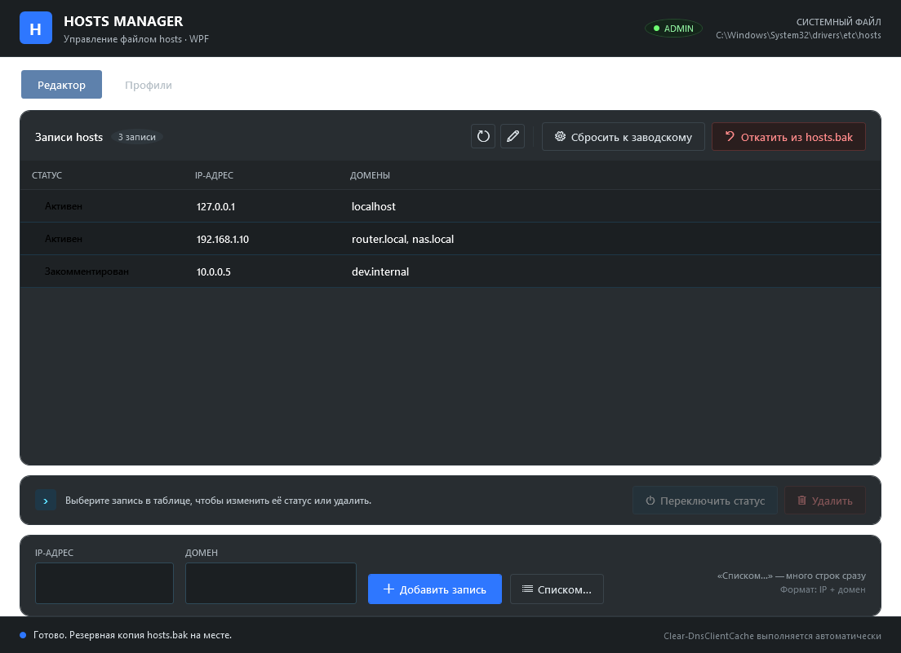
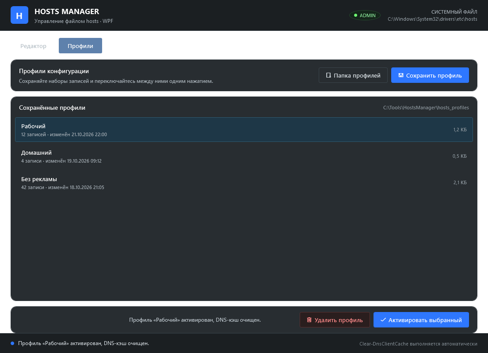

# Hosts Manager

Графическая утилита для Windows, которая делает работу с файлом `hosts` понятной: тёмный интерфейс в стиле WinUtil, список записей вместо текстового редактора, массовый импорт, профили конфигураций и страховочные копии.

Один файл `HostsManager.ps1` — без установки, зависимостей и внешних XAML.



## Возможности

- **Список записей вместо текста.** Таблица показывает статус (активна / закомментирована), IP-адрес и домены. Запись можно включить, отключить или удалить одним нажатием, двойной клик по строке переключает статус.
- **Добавление записи.** IP и домен (или несколько доменов) вводятся в форме, `Enter` подтверждает.
- **Массовое добавление.** Вставьте готовый список — утилита разберёт его, отбросит дубликаты и покажет итог до записи.
- **Профили.** Текущий `hosts` сохраняется как профиль (`.hosts`), профиль активируется одним нажатием. Удобно держать «Рабочий», «Домашний», «Без рекламы».
- **Резервные копии.** При первом запуске создаётся `hosts.bak`. Перед сбросом и восстановлением — отдельные страховочные копии, чтобы откат был всегда.
- **Сброс к заводскому шаблону Windows** и **откат из `hosts.bak`**.
- **Аккуратная запись.** Временный файл рядом с `hosts` и атомарная подмена, снятие и возврат атрибута «только для чтения», сохранение кодировки файла.
- **DNS-кэш очищается автоматически** после каждого изменения (`Clear-DnsClientCache`, при недоступности — `ipconfig /flushdns`).
- **Права администратора.** Если их нет, утилита предлагает перезапуститься с повышением через UAC.
- **Тёмная тема, включая заголовок окна**, иконки Segoe MDL2 Assets, статус-бар с результатом последней операции.

## Скриншоты

Редактор записей:


Профили конфигураций:



## Требования

- Windows 10 или Windows 11.
- Windows PowerShell 5.1 (входит в систему) либо PowerShell 7.
- Права администратора — без них `hosts` защищён системой.
- WPF входит в .NET Framework, отдельно устанавливать ничего не нужно.

## Запуск

1. Скачайте репозиторий (Code → Download ZIP) и распакуйте в папку, **доступную для записи** — рядом со скриптом создаётся папка профилей `hosts_profiles`.
2. Запустите `HostsManager.ps1`:
   - правый клик по файлу → **«Выполнить с помощью PowerShell»**;
   - либо в консоли:

```powershell
powershell -NoProfile -ExecutionPolicy Bypass -File .\HostsManager.ps1
```

Если прав администратора нет, появится окно с предложением перезапуститься — Windows покажет запрос UAC.

Консольное окно PowerShell скрывается на время работы и возвращается после закрытия утилиты.

## Как пользоваться

### Редактор

| Действие | Как |
| --- | --- |
| Обновить список | кнопка ⟳ или переключение вкладки |
| Открыть `hosts` в Блокноте | кнопка с карандашом |
| Включить / отключить запись | выбрать строку → «Переключить статус» (или двойной клик) |
| Удалить запись | выбрать строку → «Удалить» (с подтверждением) |
| Добавить запись | заполнить IP и домен → «Добавить запись» |
| Добавить списком | «Списком…» → вставить текст → проверить предпросмотр |

Записи, закомментированные вручную (`# 0.0.0.0 site`), показываются как «Закомментирован» и не мешают добавить тот же домен заново.

### Массовое добавление

Вставьте строки в любом из форматов:

```text
# комментарий и пустые строки игнорируются
0.0.0.0 ads.example.com
127.0.0.1 site.local router.local nas.local
site.local                      # без IP подставится 127.0.0.1
https://example.com/page        # из ссылки берётся только домен
::1 site.local                  # IPv6, dual-stack
```

Правила разбора:

- несколько доменов в строке разделяются пробелами, запятыми или точками с запятой;
- комментарий после `#` отрезается;
- `[::1]` приводится к `::1`;
- дубликаты отбрасываются **в пределах семейства адресов**: `0.0.0.0 site.local` и `:: site.local` — разные записи и обе сохранятся;
- строки, похожие на IP, но не являющиеся корректным адресом (например, `fe80::1%12` или `::ffff:1.2.3.4`), пропускаются целиком, а не превращаются в домен;
- числа, записанные через точки (`1.2.3.4`), не принимаются как домен.

Перед записью показывается предпросмотр: сколько записей будет добавлено и сколько строк пропущено.

### Профили

- **«Сохранить профиль»** — текущее содержимое `hosts` копируется в `hosts_profiles\<имя>.hosts`. Недопустимые символы в имени заменяются, при совпадении имени предлагается перезапись.
- **«Активировать выбранный»** — профиль копируется в `hosts`, DNS-кэш очищается.
- **«Удалить профиль»** — удаление с подтверждением.
- **«Папка профилей»** — открывает `hosts_profiles` в Проводнике.

### Резервные копии и откат

| Файл | Когда создаётся | Что содержит |
| --- | --- | --- |
| `C:\Windows\System32\drivers\etc\hosts.bak` | при первом запуске утилиты | снимок `hosts` до первого изменения |
| `hosts_profiles\hosts.before-reset.bak` | перед сбросом к заводскому | `hosts` на момент сброса |
| `hosts_profiles\hosts.before-restore.bak` | перед откатом из `hosts.bak` | `hosts` на момент отката |

`hosts.bak` создаётся один раз и не перезаписывается — это точка возврата к состоянию «как было до утилиты». Кнопка **«Откатить из hosts.bak»** заменяет текущий `hosts` этой копией, предварительно сохранив текущее состояние в `hosts.before-restore.bak`.

**«Сбросить к заводскому»** записывает стандартный шаблон Windows (закомментированные `localhost`, без пользовательских записей). Это не `hosts.bak`: перед сбросом текущий файл сохраняется в `hosts.before-reset.bak`.

## Где что лежит

```text
HostsManager.ps1                  сама утилита
hosts_profiles\                   профили и страховочные копии (создаётся автоматически)
  <имя>.hosts                     профиль
  hosts.before-reset.bak          копия перед сбросом
  hosts.before-restore.bak        копия перед откатом
HostsManager.error.log            лог необработанных ошибок запуска (если случились)
C:\Windows\System32\drivers\etc\hosts      системный файл
C:\Windows\System32\drivers\etc\hosts.bak  первая резервная копия
```

Папка `hosts_profiles` находится рядом со скриптом, поэтому не запускайте утилиту из `Program Files` — там нет прав на запись. Если папка недоступна, утилита сообщит об этом в статус-баре.

## Ограничения и безопасность

- Утилита меняет только сам файл `hosts` и не трогает другие системные настройки.
- Кодировка файла определяется автоматически (UTF-8 с BOM, UTF-8 без BOM, ANSI) и сохраняется при записи.
- Атрибут «только для чтения» снимается на время записи и возвращается обратно.
- Запись выполняется через временный файл и `File.Replace`, поэтому при сбое не остаётся наполовину записанного `hosts`; если атомарная замена недоступна, используется прямая запись.
- Профили и резервные копии — обычные текстовые файлы, их можно хранить в git или синхронизировать. В этом репозитории папка `hosts_profiles` намеренно в `.gitignore`: там могут быть личные записи.

## Устранение неполадок

- **Окно не появилось.** Проверьте `HostsManager.error.log` рядом со скриптом (или в `%TEMP%`).
- **«Запрос прав администратора был отменён».** Запустите файл вручную от имени администратора.
- **Не удаётся записать `hosts`.** Файл может блокировать антивирус или другой редактор; закройте их и повторите.
- **Изменения не применились сразу.** DNS-кэш очищается автоматически, но браузеры держат собственный кэш — перезапустите браузер.
- **Профили не сохраняются.** Скрипт лежит в папке без прав на запись — перенесите его, например, в `C:\Tools\HostsManager`.

## Лицензия

[MIT](LICENSE) © 2026 megadaun77
